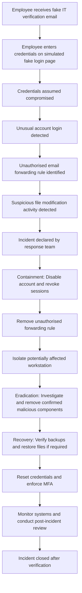

# Incident Attack Flow Diagram

## Phishing-Based Account Compromise and Suspected Ransomware Activity

This diagram represents the sequence of events in the fictional Apex Technologies incident.

## Explanation of the Flow

1. **Attack initiation:** An employee receives a fraudulent IT verification email.
2. **Credential compromise:** The employee enters credentials on a simulated fake login page.
3. **Detection:** Monitoring identifies an unusual login and an unauthorised forwarding rule.
4. **Suspicious activity:** Unusual file modifications raise concern about possible ransomware activity.
5. **Incident response:** The response team declares an incident and begins containment.
6. **Eradication:** The team investigates and removes malicious components if confirmed.
7. **Recovery:** Backups are verified, affected services are restored if necessary, and account security is strengthened.
8. **Post-incident review:** The team documents lessons learned and monitors the environment.

## Important Clarification

The suspicious file activity is not proof of a ransomware infection. The scenario treats it as a potential ransomware indicator requiring investigation.

All events and activities shown are fictional and created for an academic simulation.
